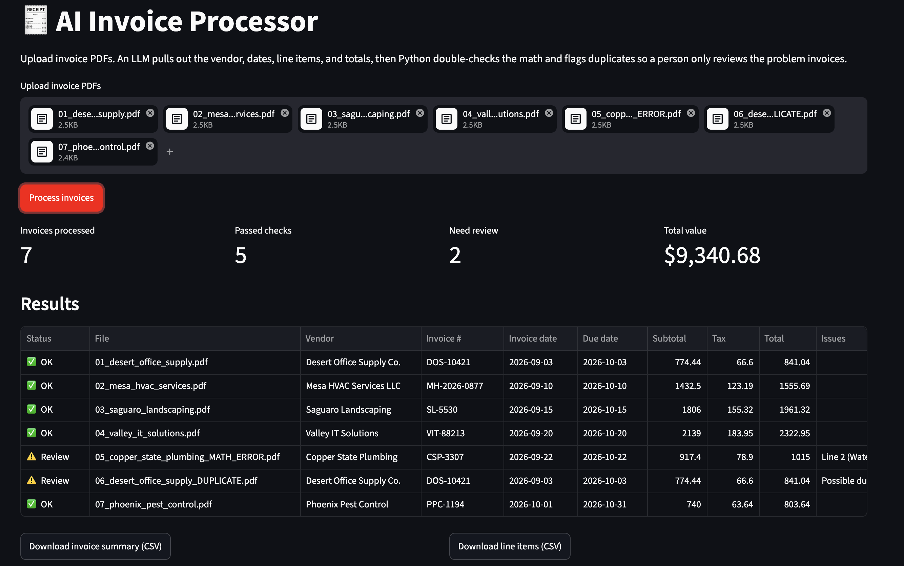

# 🧾 AI Invoice Processor

**Live demo:** https://jax-invoice-ai.streamlit.app

An AI tool that reads invoice PDFs, pulls out the key data, and flags the ones a person actually needs to look at.



## The problem

Accounts-payable teams spend hours typing invoice details into spreadsheets by hand: vendor, invoice number, dates, line items, totals. It's slow, and mistakes like a wrong line amount or the same invoice paid twice slip through.

## What it does

1. **Upload** one or more invoice PDFs.
2. **Extract:** an LLM reads each invoice and returns structured data (vendor, invoice #, dates, line items, subtotal, tax, total).
3. **Validate:** plain Python double-checks the AI's output instead of trusting it blindly:
   - Does each line's quantity × unit price equal its amount?
   - Do the line items add up to the subtotal?
   - Does subtotal + tax equal the total?
   - Has this vendor + invoice number already been processed (possible duplicate payment)?
   - Are any required fields missing?
4. **Review & export:** a dashboard shows which invoices passed and which need review, with CSV downloads of the invoice summary and every line item.

## Results on the sample set

The `sample_invoices/` folder has 7 fictional invoices, including two with planted problems:

| Invoice | Planted problem | Caught? |
|---|---|---|
| `05_copper_state_plumbing_MATH_ERROR.pdf` | One line amount is wrong and the total doesn't add up | ✅ Yes |
| `06_desert_office_supply_DUPLICATE.pdf` | Same invoice submitted twice | ✅ Yes |

All 7 invoices extracted correctly (vendor, invoice #, dates, totals) · 2 of 2 planted errors caught · 0 false flags

## How it works

```
Invoice PDF ──► pdfplumber (text) ──► LLM via Groq (structured JSON) ──► Python validation ──► Streamlit dashboard + CSV
```

**Design choice:** the AI does the reading, but the math checks are deterministic Python. LLMs can misread or "fix" numbers, so the prompt tells the model to copy numbers exactly as printed, and code does the verifying. That way the tool catches errors on the invoice *and* errors by the AI.

| File | Purpose |
|---|---|
| `app.py` | Streamlit web app (upload, results table, downloads) |
| `extractor.py` | PDF reading, LLM extraction prompt, validation checks |
| `generate_samples.py` | Creates the fictional test invoices |

## Tech stack

Python · Streamlit · pdfplumber · pandas · Groq API (`openai/gpt-oss-120b`) · Streamlit Community Cloud

## Run it locally

```bash
git clone https://github.com/jaxzader/invoice-ai.git
cd invoice-ai
pip install -r requirements.txt
streamlit run app.py
```

Get a free API key at [console.groq.com/keys](https://console.groq.com/keys) and paste it into the sidebar, or save it in `.streamlit/secrets.toml` (see `secrets.toml.example`).

## Next steps

- [ ] Scanned invoices: add OCR for image-only PDFs
- [ ] Measure extraction accuracy on a larger labeled invoice dataset
- [ ] Match invoices against purchase orders (three-way match)
- [ ] Export directly to accounting software (QuickBooks, Excel templates)
- [ ] Flag unusual amounts compared with a vendor's past invoices

## Note

All sample invoices are fictional, generated by `generate_samples.py`. No real company or financial data is used.

---
Built by **Jax Zader**, AI in Business, Arizona State University (W. P. Carey) · [LinkedIn](https://linkedin.com/in/jaxzader)
